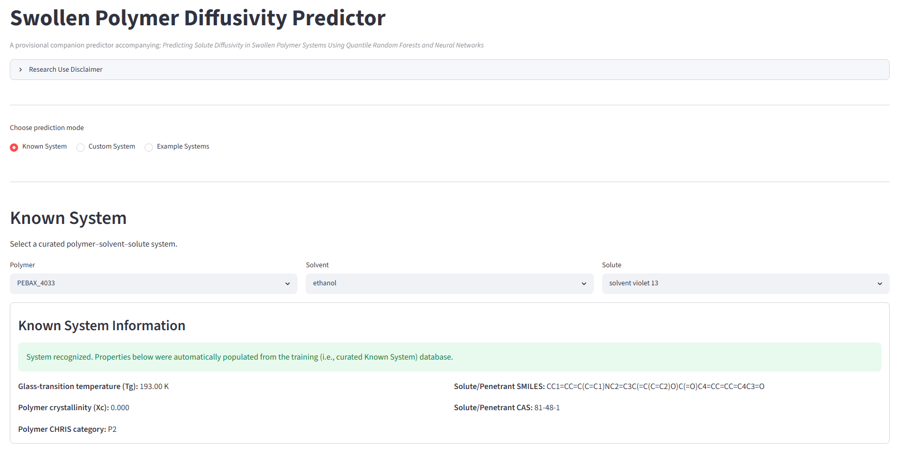

# Swollen Polymer Diffusivity Predictor

*A provisional companion predictor accompanying*

> **Predicting Solute Diffusivity in Swollen Polymer Systems Using Quantile Random Forests and Neural Networks**

---

## Launch the Companion Predictor

The interactive companion predictor is available at:

**https://swollen-polymer-diffusivity-predictor.streamlit.app/**

---

## Overview



The **Swollen Polymer Diffusivity Predictor** provides an interactive implementation of the machine-learning framework developed for predicting solute diffusivity in swollen polymer systems.

The current deployment uses the **Baseline applicability-gated hybrid (AGH)** as the headline predictor. AGH combines two constituent models:

- a 300-tree quantile random forest (QRF); and
- a 20-member multilayer perceptron (MLP) ensemble.

For each query, Mahalanobis distance ($d_M$) is calculated in the numeric Baseline descriptor space. The MLP supplies the central prediction when the query lies within the learned applicability region; QRF is selected otherwise. The interface reports the selected constituent, $d_M$, the learned deployment cutoff, and the underlying QRF and MLP predictions.

The companion predictor is intended to facilitate:

- manuscript reproducibility;
- exploratory analysis;
- educational use; and
- rapid evaluation of polymer–solute–solvent systems.

### Deployment and manuscript-validation populations

The live predictor uses the **Version-12 prospective deployment model**, trained on **2,095 observations across 28 polymers**. This deployment population contains the 2,032-observation primary manuscript dataset together with 63 additional observations used to expand the prospective deployment domain.

The manuscript validation results remain frozen to the original **2,032-observation, 27-polymer** population. The expanded deployment model is therefore intended for prospective prediction and does not replace or retrospectively alter the manuscript validation statistics.

---

## Prediction Modes

### Known System

Known System mode provides a guided interface for polymer–solvent–solute combinations contained in the curated reference database.

Users select:

- Polymer
- Solvent
- Solute

The predictor automatically populates:

- Glass-transition temperature (Tg)
- Polymer crystallinity (Xc)
- CHRIS category
- Solute SMILES
- Solute CAS number

The user supplies:

- Temperature
- Swollen/dry mass ratio
- Polymer density
- Solvent density

### Custom System

Custom System mode accepts the practical inputs required by the reference prediction engine.

Inputs include:

- Temperature
- Glass-transition temperature
- Swollen/dry mass ratio
- Polymer density
- Solvent density
- Polymer crystallinity
- CHRIS category
- SMILES (preferred) or CAS number

The predictor calculates the required swelling and molecular descriptors internally.

### Example Systems

Example Systems mode provides representative preconfigured systems that can be used to explore the prediction workflow and applicability-gated behavior.

---

## Baseline Feature Representation

The final deployment models use the following numeric Baseline descriptors:

- reduced temperature, $T/T_g$
- glass-transition temperature, $T_g$
- solute molecular weight
- solvent volume fraction, $\phi_1$
- solvent mass fraction, $\omega_1$
- $Q_v-1$
- $Q_w-1$
- polymer crystallinity, $X_c$

The CHRIS polymer transport category is included as a categorical predictive feature.

Mahalanobis distance is calculated using only the eight numeric Baseline descriptors after the preprocessing transformation fitted to the deployment training population. CHRIS category is not included in the Mahalanobis-distance calculation.

---

## Prediction Outputs

### Baseline Applicability-Gated Hybrid

Baseline AGH is the headline predictor.

For each query, the interface reports:

- AGH prediction in $\log_{10}(D)$
- AGH prediction in cm²/s
- selected constituent model
- Mahalanobis distance, $d_M$
- learned deployment cutoff
- applicability status

The Version-12 deployment rule is:

> **MLP if $d_M < d_{M,\mathrm{cut}}$; QRF otherwise.**

The current deployment cutoff is stored with the trained Version-12 model artifacts rather than hard-coded into the Streamlit interface.

### Quantile Random Forest

The QRF empirical prediction distribution consists of predictions from the 300 trees comprising the trained random forest.

Reported quantities include:

- 5th percentile
- median (50th percentile)
- 95th percentile

### MLP Ensemble

The MLP empirical prediction distribution consists of predictions from 20 independently initialized neural networks.

Reported quantities include:

- 5th percentile
- median (50th percentile)
- 95th percentile

### AGH selected prediction distribution

AGH does not construct a synthetic mixture of the QRF and MLP prediction distributions. Instead, its empirical prediction distribution is the distribution of the constituent selected by the applicability gate:

- **20 values** when MLP is selected;
- **300 values** when QRF is selected.

The reported empirical prediction-variability ranges are not formally calibrated probabilistic confidence or credible intervals.

QRF–MLP disagreement is retained as a secondary model diagnostic but is not interpreted as a calibrated confidence or applicability measure.

---

## Monte Carlo Sampling

The interface can generate user-requested Monte Carlo samples for:

- QRF
- MLP
- Baseline AGH

QRF samples are drawn with replacement from the fixed 300-tree empirical prediction distribution. MLP samples are drawn with replacement from the fixed 20-member ensemble distribution. AGH samples are drawn from the empirical distribution of whichever constituent is selected by the applicability gate.

Changing the requested Monte Carlo sample size does **not** change the trained-model prediction distributions, AGH central prediction, Mahalanobis distance, or routing decision.

---

## Downloads

The interface provides separate downloadable files for compact prediction summaries, model-derived prediction distributions, and requested Monte Carlo samples.

Available exports include:

- prediction summary CSV
- model-derived distributions CSV
- Monte Carlo samples CSV
- prediction summary JSON
- complete prediction JSON

The exports include user inputs, model provenance, AGH central prediction, selected constituent, Mahalanobis distance, deployment cutoff, applicability status, QRF and MLP distribution summaries, AGH selected-distribution information, and requested Monte Carlo results.

---

## Research Use Disclaimer

This provisional companion predictor accompanies the manuscript

> **Predicting Solute Diffusivity in Swollen Polymer Systems Using Quantile Random Forests and Neural Networks** [Citation details will be provided as soon as they become available.]

It is provided by the authors to facilitate reproducibility, exploratory analysis, educational use, and application of the machine-learning models in the current work.

The predictor is a provisional research implementation and is **not** an FDA-qualified Regulatory Science Tool (RST), Medical Device Development Tool (MDDT), or FDA-approved decision-support tool.

Predictions generated by this predictor should not replace experimental measurements, engineering judgment, or established regulatory evaluation procedures.

The findings and conclusions in the accompanying manuscript are those of the authors and do not necessarily represent any determination or policy of the U.S. Food and Drug Administration. The mention of commercial products, their sources, or their use in connection with material reported therein is not to be construed as either an actual or implied endorsement of such products by the Department of Health and Human Services.

Information regarding FDA-qualified tools is available through:

- **CDRH Regulatory Science Tool (RST) Catalog**  
  https://cdrh-rst.fda.gov/

- **Medical Device Development Tool (MDDT) Program**  
  https://www.fda.gov/medical-devices/medical-device-development-tools-mddt

---

## Repository Structure

```text
app.py                 # current production entrypoint
app_v1.py
app_v2.py
app_v3.py
app_v3_b.py

predictor/
    predict_v3.py
    downloads_v3.py
    known_system_v2.py

    reference/
        wrapper_v3.py
        saved_models_v3/
            qrf_pipeline.joblib
            mlp_128_64_pipeline.joblib
            mahalanobis_reference.joblib
            model_metadata.json
            agh_metadata.json
            mlp_ensemble/

data/
    known_system_database_v2.csv

assets/
docs/
examples/
```

The versioned v1/v2 files and model artifacts are retained for provenance and rollback. The production `app.py` uses the v3 Baseline-AGH implementation.

---

## Local Launch

From the repository root:

```bash
python -m streamlit run app.py
```

The deployment environment must contain the dependencies listed in `requirements.txt`, including the packages required to load the trained scikit-learn models and calculate molecular descriptors.

---

## Citation

If this companion predictor contributes to your work, please cite:

> **Predicting Solute Diffusivity in Swollen Polymer Systems Using Quantile Random Forests and Neural Networks** [Citation details will be provided as soon as they become available.]

---

## Current Status

Current development milestone:

**Version 3.0 — Baseline AGH deployment**

- Version-12 prospective deployment engine integrated
- 2,095-observation / 28-polymer deployment population
- Baseline descriptor representation
- 300-tree QRF integrated
- 20-member MLP ensemble integrated
- Mahalanobis-distance applicability reference integrated
- applicability-gated QRF/MLP routing implemented
- Known System, Custom System, and Example Systems supported
- model-derived and Monte Carlo distributions distinguished explicitly
- CSV and JSON exports implemented
- prediction results persist during sequential downloads
- manuscript validation remains frozen to the primary 2,032-observation population

Future releases may expand the curated Known System database and deployment population while preserving explicit provenance between manuscript-validation and prospective-deployment models.